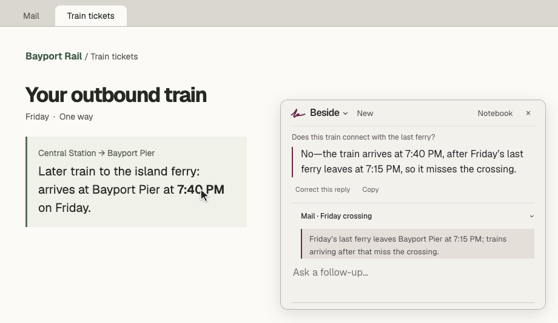

# Beside

Beside is a floating assistant for your Mac. Point at a line in another app and ask a question. Beside can connect what you’re reading to something you’ve saved, draft a reply, or show you the passage behind an answer.

[Download Beside for Mac](https://github.com/pranavdulepet/beside/releases/latest/download/Beside-macOS.zip) · [Watch Beside catch a missed connection](docs/walkthroughs.md)

## Try Beside

1. **Check your Mac.** Open the Apple menu → **About This Mac**. You’ll need an Apple M-series chip and macOS 14 or later. The built-in model downloads need at least 16 GB of memory.
2. **Open Beside.** Double-click the downloaded ZIP, drag **Beside** to **Applications**, then open it. The download is ad-hoc signed. If macOS asks you to review the app, see [Apple’s guide to opening downloaded apps](https://support.apple.com/en-us/102445).
3. **Set up local answers.** In the floating sheet, click **Notebook**, then **Use a model on this Mac**. Beside finds an installed model or offers a download that fits. Let the download finish, select **Continue**, then draw your mark or choose **Skip for now**. Local answers work without a subscription.
4. **Give it a page to read.** Open TextEdit. Choose **Ask about this Mac** from Beside’s menu bar icon. Click the Beside mark → **Sources** → **Selected apps & sites**. Choose **+ Add open app**, pick **TextEdit**, and select **Start**. Allow Screen Recording in macOS if prompted.
5. **Ask your first question.** In TextEdit, type “Friday’s last ferry leaves Bayport Pier at 7:15 PM.” With that line visible, tap **⌥⇧Space** (Option–Shift–Space), type **When is the last ferry?**, and press Return. Read the answer, then press **Esc** to return to TextEdit. You can also hold the shortcut to speak.

### Would I make the last ferry?

You’re about to book a train that arrives at 7:40 PM. Point at the train and ask **“Does this train connect with the last ferry?”** Beside finds the email you read earlier. The ferry leaves at 7:15 PM. You’d miss it by 25 minutes. Open the email citation to check the time while the ticket is still on screen.

## Make it yours

Import Apple Notes or an Apple Mail mailbox in **Sources**. Next time a conversation sounds familiar, ask “Does this relate to anything I saved?” Open the source beneath the answer to check it. Choose **Correct this reply** to teach Beside a preference. You can review or retire it later.

Your notebook lives on your Mac. Screen passages and floating chats use an encrypted database. Some notebook files and exports are readable in Finder. Public web searches send search terms to Exa. Cloud models can receive the context you choose to share. You can pause observation from the menu bar.

[User guide and troubleshooting](docs/guide.md) · [Security](SECURITY.md) · [Build from source](docs/development.md) · [Contribute](CONTRIBUTING.md) · [License](LICENSE) · [Third-party credits](licenses/)
