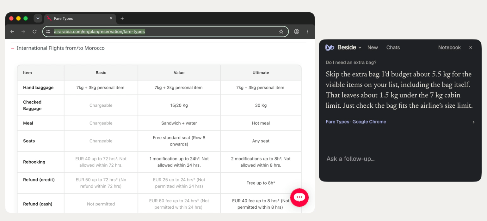

# Beside

Beside is a floating assistant for your Mac. Point at the thing you’re working on and ask. It can bring back a detail from an email you read earlier, right where you need it.

[Download Beside for Mac](https://github.com/pranavdulepet/beside/releases/latest/download/Beside-macOS.zip) · [Watch Beside check a carry-on](docs/walkthroughs.md)

## Try Beside

1. **Check your Mac.** Open the Apple menu → **About This Mac**. You’ll need an Apple M-series chip and macOS 14 or later. The built-in model downloads need at least 16 GB of memory.
2. **Open Beside.** Double-click the downloaded ZIP, drag **Beside** to **Applications**, then open it. The download is ad-hoc signed. If macOS asks you to review the app, see [Apple’s guide to opening downloaded apps](https://support.apple.com/en-us/102445).
3. **Set up local answers.** In the floating sheet, click **Notebook**, then **Use a model on this Mac**. Beside finds an installed model or offers a download that fits. Let the download finish, select **Continue**, then draw your mark or choose **Skip for now**. Local answers work without a subscription.
4. **Turn on screen memory.** In the floating sheet, click the Beside mark → **Sources** → **All displays**. Allow Screen Recording, then select **Start**. Beside can now remember visible passages as you move between apps. You can pause it from the menu bar.
5. **Ask from the app you’re using.** Point at the booking or document, tap **⌥⇧Space** (Option–Shift–Space), type your question and press Return. Press **Esc** to return to your work. Hold the shortcut to speak.

### Do I need an extra bag?

On Air Arabia’s Morocco fare page, tap **⌥⇧Space** and ask **“Do I need an extra bag?”** Beside finds the trip’s packing list and budgets **5.5 kg** for the daypack and its contents. The cabin allowance is **7 kg**. **Skip the extra bag.**

[User guide and troubleshooting](docs/guide.md) · [Storage and sharing](docs/guide.md#where-your-data-lives) · [Security](SECURITY.md) · [Build from source](docs/development.md) · [Contribute](CONTRIBUTING.md) · [License](LICENSE) · [Third-party credits](licenses/)
