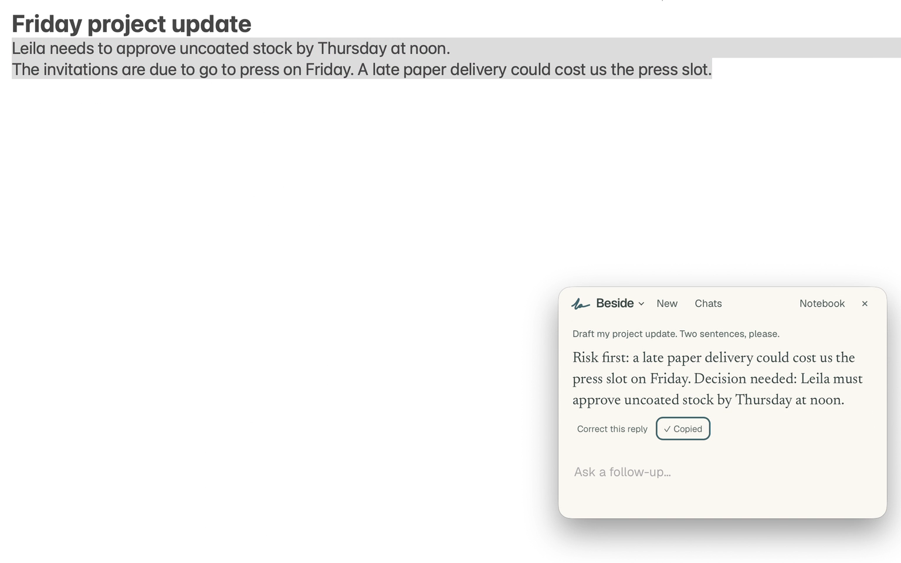

# Beside

Beside is a floating assistant for your Mac. Point at what you’re working on and press **⌥⇧Space** to ask a question. It can find a detail in a closed note, adjust a plan when you change your mind, and remember how you want the next draft written.

[Download Beside for Mac](https://github.com/pranavdulepet/beside/releases/latest/download/Beside-macOS.zip) · [Watch Beside on a Mac](https://pranavdulepet.github.io/beside/#demo)

## Try Beside

1. **Check your Mac.** Open the Apple menu → **About This Mac**. You’ll need an Apple M-series chip and macOS 14 or later. The built-in model downloads need at least 16 GB of memory.
2. **Open Beside.** Double-click the downloaded ZIP, drag **Beside** to **Applications**, then open it. The download is ad-hoc signed. If macOS asks you to review the app, see [Apple’s guide to opening downloaded apps](https://support.apple.com/en-us/102445).
3. **Choose local answers.** The floating sheet offers a model that fits your Mac. It can use an installed copy of Inkling, download one, or open a GGUF file you already have.
4. **Choose what Beside sees.** Select **Turn on screen memory** to remember work between visits, **Only when I ask** for a one-time look, or **Keep it off**. When macOS asks, allow Screen Recording and return to Beside.
5. **Ask beside your work.** Point at the relevant part of a window. Tap **Option–Shift–Space** to type, or hold it to speak. Press **Esc** to go back. The notebook and local model live on your Mac.

## See it in use

- Ask Beside to open project updates with the risk. In a fresh chat, see how it starts a different brief. [A correction that sticks](https://pranavdulepet.github.io/beside/#learning)
- Add two dinner guests, check what’s in the pantry, and paste the revised Trader Joe’s list into Notes. [Groceries](https://pranavdulepet.github.io/beside/#groceries)
- Open a printer’s email and ask for the file format, bleed and deadline from a saved handoff note. [Print handoff](https://pranavdulepet.github.io/beside/#email)
- Start with an empty notebook, connect an installed local model, and save your first preference. [First-time setup](https://pranavdulepet.github.io/beside/#setup)

[User guide](docs/guide.md) · [Walkthroughs](docs/walkthroughs.md) · [Architecture](docs/architecture.md) · [Storage and sharing](docs/guide.md#where-your-data-lives) · [Security](SECURITY.md) · [Build from source](docs/development.md) · [Contribute](CONTRIBUTING.md) · [License](LICENSE) · [Third-party credits](licenses/)
