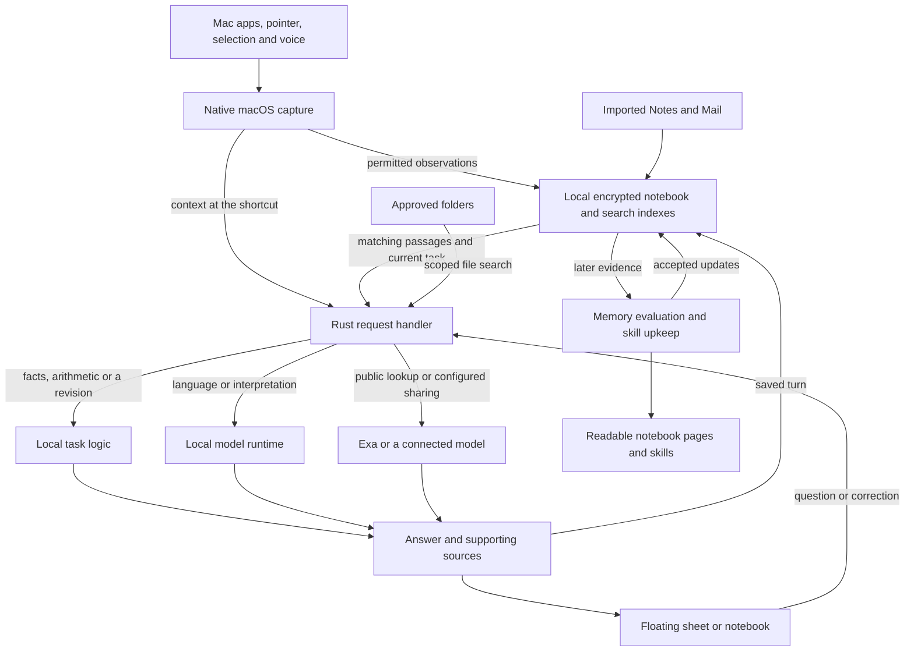

# How Beside works

When you ask “Do I need a second bag?”, Beside needs three things from different places. The fare is on screen, the packing list may be in a closed note, and the suitcase weight might be something you tell it next. This guide follows those inputs through the Mac app, including what gets saved, when a model runs and what can leave the device.

## From the shortcut to the answer

1. **Capture what the question refers to.** A tap on **⌥⇧Space** takes a snapshot of the pointer target, front window and available selection before the floating sheet takes focus. Holding the shortcut starts on-device speech recognition. The React sheet sends the question and its context to the Rust process through Tauri. The notebook is a second view into that same process. [Shortcut and windows](../src-tauri/src/main.rs) · [Pointer targeting](../src-tauri/src/point.rs) · [Speech](../src-tauri/voice.m) · [Floating sheet](../src/Activity.tsx)
2. **Find evidence.** Rust looks up eligible passages by text, source and time. SQLite FTS5 ranks word matches with BM25. A 192-dimensional vector index helps when there are few text matches. A question about “anything in my notes or email” uses the current screen as the search clue and retrieves the other source independently. A saved connection carries its quoted passage and source identity so Beside can check it again. Queries about files search the folders the user granted. [Activity search](../src-tauri/src/activity.rs) · [Connections](../src-tauri/src/activity/connections.rs) · [File access](../src-tauri/src/activity_files.rs)
3. **Choose how to answer.** The floating companion has dedicated paths for tasks such as comparing baggage, preparing a shopping list, finding a related passage and drafting a reply. Other questions use a model with a bounded set of excerpts. The notebook conversation has its own router for model choice, arithmetic, dates, recall, public search and saved skills. Rust validates tool requests before execution. [Companion routing](../src-tauri/src/activity.rs) · [Notebook routing](../src-tauri/src/conversation.rs) · [Notebook tools](../src-tauri/src/desk_tools.rs)
4. **Return to the work.** The sheet can render text as it arrives, plus the supporting quotes or links. The user can open a source, copy a draft, correct the answer or dismiss the sheet. Floating chat turns and the excerpts used for them are stored together. A task follow-up must match the same chat, last turn, task type and current generation of screen memory. This keeps a correction in one chat from silently revising a different task. [Sheet](../src/Activity.tsx) · [Chat persistence and revision](../src-tauri/src/floating_chats.rs)

### One decision, end to end

On United’s baggage screen, Beside can recognize a fare and prepare a reference to the relevant packing note **before** the shortcut. When asked, it checks that the fare is still current, rereads the applicable packing evidence, separates carry-on items from checked items and compares an estimated weight with the fare’s limit. It takes the fee from the booking. In the recorded itinerary, that produces **one checked bag, estimated at 14.5 kg against 23 kg, and a recommendation to skip the $120 second bag**.

If you then say “I weighed it. It’s 21.5 kg,” the same task uses the measurement and calculates **1.5 kg to spare**. An uncertain estimate near the limit can trigger a question about the weight. The preparation caches source references. The comparison and arithmetic run in Rust, so this path can answer without waiting for model generation. [Baggage preparation, calculation and revision](../src-tauri/src/activity/baggage.rs) · [Packing estimates](../src-tauri/src/activity/packing.rs)

## What Beside can see

Screen memory uses macOS permissions and the scope chosen in Sources. Native code reads window information, Accessibility text where available and Vision OCR. The observer samples changes as windows settle, deduplicates repeat views, and saves a timestamp, source, title and passage. Optional image previews have a separate retention limit. The observer checks the lock state, secure input and excluded apps. **Last seen** reports observation separately from the last newly saved passage. [Native capture](../src-tauri/activity.m) · [Observer](../src-tauri/src/activity.rs)

Under **All displays**, the user can also include other open windows in local answers. Beside rotates through eligible windows and holds the recent excerpts in RAM. Coverage depends on what macOS exposes. A browser tab without its own window is outside this view. Apple Notes and exported Mail have separate, refreshable imports. Meeting recording has an explicit start, system window picker and stop, with optional microphone capture. [Other windows](../src-tauri/src/activity/workspace.rs) · [Imports](../src-tauri/src/activity/imported.rs) · [Meetings](../src-tauri/src/meetings.rs)

For proactive suggestions, the observer compares a new passage with earlier evidence. Relevance checks, dismissal and cooldown rules control the menu-bar dot. Opening the suggestion asks for an explanation of the specific connection. This path can surface a passage while the user stays in the original app. [Proactive matching](../src-tauri/src/proactive.rs) · [Connection evidence](../src-tauri/src/activity/connections.rs)

## Models and network boundaries

The managed runtime launches a bundled llama.cpp server on loopback, loads GGUF weights and uses Metal on Apple Silicon. Beside can keep the model warm between requests. The managed download offers **Inkling 2 Mini** on Macs with at least 32 GB of memory and **Gemma 4 12B** starting at 16 GB. Weights download separately and are checked against a pinned digest. Beside can also use an existing Ollama or LM Studio setup. [Managed runtime](../src-tauri/src/bundled.rs) · [Model selection and downloads](../src-tauri/src/weights.rs) · [Inference](../src-tauri/src/brain.rs)

Public web lookup sends a search query to Exa. A connected cloud model is a separate choice. Depending on the route and sharing settings, it can receive the question, eligible excerpts or a permitted image. At dispatch, the companion filters personal memory, limits conversation history to turns already shared with that provider, and strips the other-open-windows snapshot. Connected options include a ChatGPT plan and configured provider endpoints. A local answer based on local sources runs on the Mac. [Web search](../src-tauri/src/web_search.rs) · [Sharing boundary](../src-tauri/src/brain.rs) · [Providers](../src-tauri/src/providers.rs)

## What lives on disk

New notebooks live in `~/Beside`. The storage format depends on whether Beside or the user needs to read it directly.

| Location inside the notebook | Contents |
| --- | --- |
| `.sumi/moments.db` | SQLCipher database for captured passages, optional previews, imported material, floating chats, evidence indexes, predictions and settings. macOS Keychain holds the per-notebook key. The hidden path preserves compatibility with existing notebooks. |
| `desk/` | Readable Markdown for notebook conversations, memory pages and the compact personal summary. Floating chats use the encrypted database. |
| `scroll/` | Approved preferences, relationships and named skills in Markdown. Retired skills have their own directory. |
| `.sumi/activity-journal/` and `.sumi/meetings/` | Optional readable daily screen journals and ordinary meeting MP4s. These have different privacy properties from the encrypted database. |
| `.sumi/models/` | Downloaded local model weights. |

Screen passages age out after 30 days. Previews are limited to 24 hours and the most recent 150. Removing a captured passage invalidates linked evidence, including saved floating chats citing that passage. Removing a Notes or Mail import clears its search index. A quote already saved in a chat or portable export can still exist there. Export produces a readable archive, so access to that copy matters. [Database](../src-tauri/src/store.rs) · [Activity schema](../src-tauri/src/activity.sql) · [Export](../src-tauri/src/exports.rs) · [Storage controls](guide.md#where-your-data-lives)

## How Beside changes with use

**During a task**, Beside keeps the answer, evidence references and current task state in the encrypted conversation. “I already have tofu” can remove tofu from the current shopping list. “It weighs 21.5 kg” can revise the baggage calculation. The original note or booking stays available for checking. This is the part of the context-language-model idea implemented in the companion. Its working state lives in the chat record. [Task state](../src-tauri/src/floating_chats.rs) · [Shopping revisions](../src-tauri/src/activity/shopping.rs)

**Across tasks**, a correction can update a preference immediately. Dated memory tracks when Beside learned a fact and when it was true. Background jobs can propose longer-lived changes when the Mac is idle, on power and cool enough. For compact personal memory, Beside compares predictions with and without a proposed change on at least two later cases, then checks the inputs again before accepting it. This tests a memory change against observations. The language model’s weights stay fixed. [Memory and replay](../src-tauri/src/memory.rs) · [Background scheduler](../src-tauri/src/jobs.rs) · [Power and idle checks](../src-tauri/native.m)

The notebook’s prediction history makes part of that loop inspectable. Imported conversations supply situations paired with what the user actually did. Beside separates examples used to find patterns from examples reserved for evaluation. A scored entry records the baseline guess, personalized guess, observed outcome, rules used and grade. That score measures agreement with a held-out user action. Factual answers still depend on their sources. [Source preparation](../src-tauri/src/sources.rs) · [Prediction and scoring](../src-tauri/src/engine.rs) · [Prediction history](../src-tauri/src/mirror.rs)

The notebook can also turn repeated successful work into a named Markdown skill, select it for a later conversation, and retire it as usage changes. Approved parts of the Scroll can be shared with a connected agent through a local MCP endpoint. Each agent has revocable credentials, permitted sections and a permission level. Decisions outside its delegated scope can come back to the user. [Skills](../src-tauri/src/conversation.rs) · [Agent permissions](../src-tauri/src/seal.rs) · [Local transport](../src-tauri/src/transport.rs)

## Build and delivery

The app packages its React and TypeScript interface, Tauri Rust process, native macOS bridges and inference runtime together. The release ZIP and static GitHub Pages gallery are distribution channels. A running notebook has no dependency on the gallery. Rust tests exercise retrieval, state changes and permission boundaries. Playwright covers interface flows and gallery playback. [Build, test and package](development.md) · [Release script](../scripts/release.sh) · [Browser tests](../tests/notebook.spec.ts)
