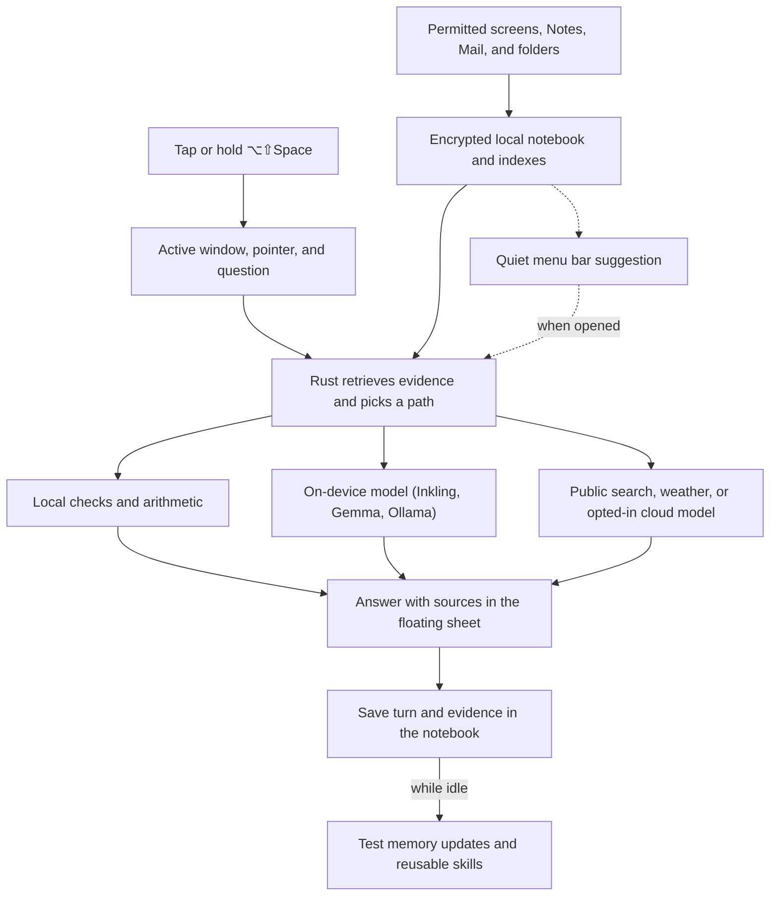

# How Beside works

Beside is a Tauri desktop app for Apple silicon Macs. A React interface renders the floating sheet and notebook, a Rust core handles storage, retrieval, and privacy boundaries, and native Objective-C bridges handle macOS screen reading, overlays, speech, and audio.

## Request flow

1. **Capture context.** Pressing **⌥⇧Space** snapshots the front window, pointer target, and selected text before the floating sheet takes focus. Holding the shortcut starts on-device speech recognition. [main.rs](../src-tauri/src/main.rs) · [point.rs](../src-tauri/src/point.rs) · [voice.m](../src-tauri/voice.m) · [Activity.tsx](../src/Activity.tsx)
2. **Retrieve evidence.** Rust searches permitted passages using full-text and local vector ranking combined, plus any folders you explicitly allowed. [activity.rs](../src-tauri/src/activity.rs) · [vectors.rs](../src-tauri/src/activity/vectors.rs) · [activity_files.rs](../src-tauri/src/activity_files.rs)
3. **Answer and verify.** Structured tasks (like baggage weight checks, shopping list revisions, and multi-source writing edits) run local checks and arithmetic before replying. General questions run on your chosen local or opted-in cloud model. [activity.rs](../src-tauri/src/activity.rs) · [conversation.rs](../src-tauri/src/conversation.rs) · [desk_tools.rs](../src-tauri/src/desk_tools.rs)
4. **Guide on screen.** When you ask where something is, Beside reads live Accessibility and Apple Vision OCR controls in the active window, binds highlights to that window’s identity and position, and clears them if the window moves or closes. [overlay.m](../src-tauri/overlay.m) · [overlay.rs](../src-tauri/src/overlay.rs)

## Proactive suggestions

While screen memory and suggestions are enabled, Beside checks window changes every ~250 ms and samples settled windows. New passages are checked against imported Notes/Mail, saved preferences, visible errors, reply opportunities, and upcoming Calendar meetings. Suggestions wait for a pause in typing, expire after four minutes, and back off for seven days when dismissed. [proactive.rs](../src-tauri/src/proactive.rs)

## Models and network boundaries

- **Local runtime:** Beside ships a loopback-only `llama.cpp` server using Metal on Apple silicon, with SHA-256 verified weights (Inkling 2 Mini on 32 GB+ Macs, Gemma 4 12B on 16 GB+ Macs) or your own Ollama / LM Studio model. [bundled.rs](../src-tauri/src/bundled.rs) · [weights.rs](../src-tauri/src/weights.rs)
- **Public search:** Standalone public questions query Exa, Brave (if configured), or DuckDuckGo without attaching private notes. [web_search.rs](../src-tauri/src/web_search.rs)
- **Optional cloud sharing:** Filters memory at dispatch, drops local window snapshots, and only shares turns already sent to that provider. **Mask identifying text** replaces personal identifiers with request-scoped aliases restored locally and keeps images on-device. **Tinfoil** verifies hardware attestation before sending prompt text. [brain.rs](../src-tauri/src/brain.rs) · [privacy_bridge.rs](../src-tauri/src/privacy_bridge.rs) · [confidential/main.go](../src-tauri/confidential/main.go)

## Storage on disk

Everything lives inside `~/Beside`:

| Path | Contents |
| --- | --- |
| `.beside/moments.db` | Encrypted SQLCipher database (chats, screen passages, imports, indexes, settings). Key stored in macOS Keychain. |
| `desk/` | Plain Markdown notebook chats, core summary, and dated memory pages. |
| `scroll/` | Approved preferences, people notes, and named skills in Markdown. |
| `.beside/models/` | Downloaded local model weights. |
| `.beside/meetings/` | Optional local meeting MP4 recordings. |

Screen passages expire after 30 days and optional previews after 24 hours. Deleting a passage or import removes its index entries and quoted copies in one transaction. [notebook_data.rs](../src-tauri/src/notebook_data.rs) · [import_quotes.rs](../src-tauri/src/floating_chats/import_quotes.rs)

## Learning and connected tools

- **Editable context & evaluation:** As chats grow, Beside maintains a compact working summary and tests inferred memory updates against held-out past replies while your Mac is idle, promoting changes only when accuracy improves with zero regressions. [memory.rs](../src-tauri/src/memory.rs) · [jobs.rs](../src-tauri/src/jobs.rs) · [engine.rs](../src-tauri/src/engine.rs)
- **Connected tools (MCP):** External tools connect over a local Unix socket with per-tool revocable tokens, section-level read permissions, and a live audit log. Autonomous answers stay off unless enabled and gated behind 20+ human-reviewed shadow trials. [seal.rs](../src-tauri/src/seal.rs) · [transport.rs](../src-tauri/src/transport.rs)
