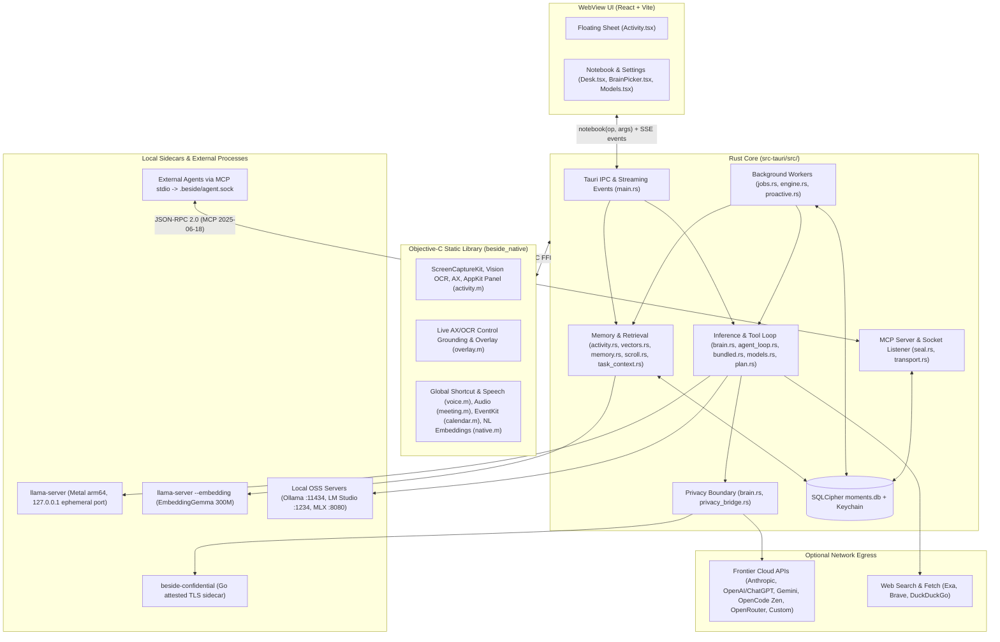
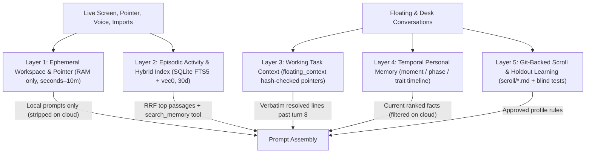
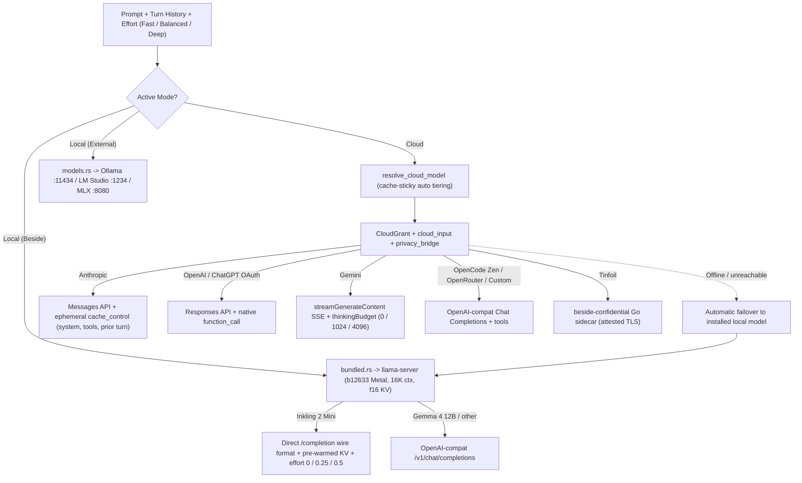
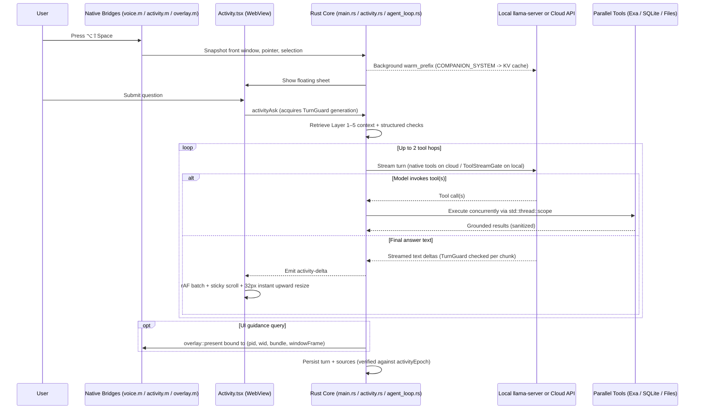
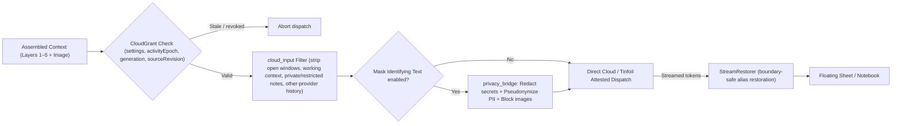

# Beside Architecture

Beside is a local-first macOS (Apple silicon) desktop application built on Tauri v2. A React WebView renders the floating sheet and notebook windows, a Rust core owns encrypted storage, five-layer memory, retrieval, model serving, tool execution, and privacy enforcement, and seven statically linked Objective-C bridges interface directly with macOS frameworks.

## 1. System Topology



### Runtime Components

- **Frontend (`src/`):** React + Vite bundle. The main window renders notebook views, settings, and model management; a secondary floating panel (`#activity` in [Activity.tsx](../src/Activity.tsx)) attaches to the active macOS space without stealing application ownership. All backend calls pass through a single `notebook(operation, args)` Tauri command; streaming responses emit `activity-delta`, `reply-delta`, `activity-expand`, and `proactive-nudge` events.
- **Rust core (`src-tauri/src/`):** Dispatches blocking database, OCR, and inference operations onto Tauri's blocking thread pool (`spawn_blocking`). Owns SQLite connection locking, key derivation, file atomicity, HTTP connection pools, process lifecycle for sidecars, and background worker threads.
- **Native macOS bridges (`src-tauri/*.m`):** Compiled via `cc` in [build.rs](../src-tauri/build.rs) as `libbeside_native` with ARC enabled and linked against `AppKit`, `ScreenCaptureKit`, `Vision`, `NaturalLanguage`, `Speech`, `AVFoundation`, `CoreMedia`, `EventKit`, `Carbon`, `PDFKit`, and `ApplicationServices`:
  - [activity.m](../src-tauri/activity.m): foreground window polling, ScreenCaptureKit capture, Apple Vision OCR, Accessibility reads, and non-activating floating panel geometry (`beside_size_panel`).
  - [overlay.m](../src-tauri/overlay.m): live UI control capture combining Accessibility trees with Vision OCR, plus window-bound highlight rendering.
  - [voice.m](../src-tauri/voice.m): global `⌥⇧Space` tap/hold gesture handler and on-device `SFSpeechRecognizer`.
  - [native.m](../src-tauri/native.m): Apple `NaturalLanguage` sentence embeddings (`beside_passage_vector`), Keychain helpers, and macOS idle-time queries.
  - [meeting.m](../src-tauri/meeting.m), [calendar.m](../src-tauri/calendar.m), [bag_vision.m](../src-tauri/bag_vision.m): local meeting capture, EventKit calendar access, and visual extraction helpers.
- **Bundled sidecars (`Contents/Resources/runtime/`):**
  - `llama-server`: pinned `llama.cpp` build (`b12633`, arm64 Metal) spawned loopback-only (`127.0.0.1:<ephemeral>`) with a per-launch random API key written to a `0600` file. Cleanup checks `/bin/ps` for PID ownership before signalling a stale process ([bundled.rs](../src-tauri/src/bundled.rs)).
  - `beside-confidential`: Go binary ([confidential/main.go](../src-tauri/confidential/main.go)) that verifies Tinfoil enclave attestation over TLS before reading prompt payload bytes from stdin.

---

## 2. Storage Layout and Encrypted Schema

All state lives inside `~/Beside` (or a user-selected notebook root). Directories are created with mode `0700`; mutable files are written atomically via temp file (`0600`) → `fsync` → `rename` ([store.rs](../src-tauri/src/store.rs)).

```text
~/Beside/
├── .beside/
│   ├── moments.db           # SQLCipher-encrypted SQLite database (WAL mode)
│   ├── agent.sock           # Unix domain socket for MCP stdio relay
│   ├── models/              # SHA-256 verified GGUF weights + .download.lock
│   ├── meetings/            # Optional local MP4 meeting recordings
│   └── owned-history        # Marker verifying Beside owns the Git repository
├── scroll/                  # Git-versioned approved profile & skills (Markdown)
│   ├── deciding.md
│   ├── writing.md
│   ├── words.md
│   ├── goals.md
│   ├── facts.md
│   └── people/relationships.md
└── desk/                    # Plain Markdown projections (untracked by Git)
    ├── core.md
    ├── memories.md
    ├── pages/<sha32>.md
    └── images/*.png
```

### Encryption and Keychain Binding

- **Database encryption ([store.rs](../src-tauri/src/store.rs)):** `.beside/moments.db` is encrypted with SQLCipher using a 32-byte random key stored in the macOS Keychain under service `studio.beside.memory` and account `SHA-256(root_path)`. On startup, Beside verifies `PRAGMA cipher_version` and refuses to overwrite an existing database if its Keychain key is absent. Connection pragmas enforce `journal_mode=WAL`, `foreign_keys=ON`, `secure_delete=ON`, and a 12-second busy timeout.
- **Provider credentials ([providers.rs](../src-tauri/src/providers.rs)):** API keys and OAuth tokens are never written to SQLite. They live in Keychain under service `studio.beside.providers`, account `<SHA-256(root_path)[..24]>-<provider>`.
- **Git isolation ([scroll.rs](../src-tauri/src/scroll.rs)):** `.gitignore` ignores everything except `scroll/` and `.gitignore`. All Git invocations force `-c core.hooksPath=/dev/null` and disable commit signing so untrusted repository hooks cannot execute.

### SQLite Schema and Deletion Invariants

Schema definitions live in [store.rs](../src-tauri/src/store.rs) and [activity.sql](../src-tauri/src/activity.sql):

| Table / Virtual Table | Role | Retention / Cascade Behavior |
| --- | --- | --- |
| `kv(k, v)` | Scalar settings, epochs (`activityEpoch`, `lastObservedAt`), cursors, `forgotNote/*` tombstones | Persistent |
| `docs(kind, id, v)` | JSON document store (`chat`, `floatingChat`, `note`, `provider`, `agent`, `log`, `route`, `blind`, `prediction`, `version`, `tune`, `source`) | Explicit delete or trigger cascade |
| `imported_messages` | Imported transcript rows used for moment ingestion and ZIP export | Persistent until forgotten |
| `moments(id, source, stamp, situation, action, split)` | Behavioral examples split into `train` and `test` holdout sets | Used by idle evaluation |
| `vectors` (`vec0`, `float[192]`) | Moment embeddings for offline rule evaluation | Paired with `moments` |
| `floating_context(chat PK, covered, through_turn, refs)` | Hash-verified pointer list for long floating chats | `ON DELETE CASCADE` on `docs('floatingChat', chat)` |
| `activity(id, source, title, body, stamp, digest)` | Captured screen OCR / Accessibility passages | 30-day rolling retention |
| `activity_previews(event PK, jpeg)` | Optional JPEG thumbnails for screen passages | 24-hour retention; `ON DELETE CASCADE` on `activity` |
| `activity_search` (`fts5`, `porter unicode61`) | Full-text index over `activity(title, body, source)` | Maintained by `AFTER INSERT` / `AFTER DELETE` triggers |
| `activity_vectors` (`vec0`, `space` partition, `float[192]`) | Dense/native passage embeddings partitioned by embedding space | Deleted by `activity_unembed` trigger |
| `activity_habits`, `activity_support` | Observed screen habits linked to supporting `activity` rows | `BEFORE DELETE` trigger deletes habits when support is removed |
| `activity_dirty(day)` | Tracks calendar dates whose daily Markdown export needs refresh | Populated by insert/delete triggers on `activity` |
| `imported_passages` (`fts5`, `porter unicode61`) | Full-text index over imported Apple Notes and Mail | Cleaned on re-import or removal |
| `prepared_baggage`, `proactive_dismissals`, `proactive_feedback` | Structured baggage cache and proactive cooldown/feedback state | `prepared_baggage` cascades from `activity`; proactive tables bounded at 100 / 128 rows |

**Transactional forgetting guarantees:**

1. Deleting any `activity` row triggers atomic removal of its `activity_vectors` row, `activity_search` FTS entry, `activity_previews` JPEG, dependent `activity_habits`, and any `floatingChat` in `docs` whose `turns[].sources[].id` matches `OLD.id` ([activity.sql](../src-tauri/src/activity.sql)).
2. Deleting or updating imported Notes/Mail invokes [import_quotes.rs](../src-tauri/src/floating_chats/import_quotes.rs), which scrubs removed verbatim quotes (`[quote removed]`) and source citations from historical `floatingChat` turns in the same transaction.
3. Any forget or scope change bumps `activityEpoch` in `kv`. In-flight answers and async UI tasks compare their captured epoch before committing writes, preventing deleted passages from re-entering history.

---

## 3. Memory Architecture

Beside splits context into five distinct layers ordered by lifespan, mutability, and verification bar.



### Layer 1: Ephemeral Screen, Workspace, and Pointer Context

- **Foreground observer ([activity.rs](../src-tauri/src/activity.rs)):** `observe_foreground` polls the frontmost window identity roughly every 250 ms. On a window change, `CaptureSchedule` captures immediately and schedules one 550 ms follow-up sample (letting editors finish updating content after a title change); while the window stays unchanged, sampling drops to every 5 seconds.
- **Ask-time freshness:** When the user asks a question, Beside skips synchronous inline OCR unless `lastObservedAt` is at least 15 seconds stale, removing OCR stall from normal TTFT.
- **Open-window snapshot ([activity/workspace.rs](../src-tauri/src/activity/workspace.rs)):** Cached in memory for 15 seconds. Local prompts receive up to 12 open windows, with a 420-character text excerpt attached only for the frontmost window and up to 2 windows whose titles/text match query terms. The entire `open_windows_on_this_mac` structure is stripped before any cloud request.
- **Pointer & selection gesture ([point.rs](../src-tauri/src/point.rs)):** Captured synchronously when `⌥⇧Space` fires and held in a RAM mutex (`LAST`) with a 10-minute expiry. Under `scope == "on-demand"`, it is never persisted to SQLite.

### Layer 2: Episodic Activity and Hybrid Retrieval

Every saved passage is indexed in both `activity_search` (FTS5 with `porter unicode61`) and `activity_vectors` (`sqlite-vec` `vec0` with 192 `f32` dimensions partitioned by `space`).

**Retrieval fusion ([activity.rs](../src-tauri/src/activity.rs), [activity/vectors.rs](../src-tauri/src/activity/vectors.rs)):**

1. **Lexical pass:** FTS5 query ranked by `bm25(activity_search, 3, 1, 2)` (title weight 3, body weight 1, source weight 2), taking up to 16 rows.
2. **Semantic pass:** `vec0` L2 nearest-neighbor search within the active `space` partition (`k = 64`, distance `< 0.78`), taking up to 16 rows.
3. **Reciprocal Rank Fusion (`vectors::fuse`):** Both lists combine via:

$$\text{score}(id) = \sum_{L \in \{\text{lexical}, \text{semantic}\}} \frac{1}{61 + \text{rank}_L(id)}$$

Ties break by descending timestamp, then passage ID.

**Embedding spaces and projection:**

| Priority | Space Prefix | Source | Dimensions & Projection |
| --- | --- | --- | --- |
| 1 (optional dense) | `beside-jl1-<sha256>` or `ollama-jl1-<sha256>` | Bundled `EmbeddingGemma 300M` (`Q8_0`, 334 MB) or `BESIDE_OLLAMA_EMBED_MODEL` via dedicated `llama-server --embedding --pooling mean` | Sparse Johnson-Lindenstrauss projection (3 deterministic signed SplitMix64 probes per input coordinate) into 192 `f32`, L2-normalized |
| 2 (default native) | `apple-jl1-<rev>` | Apple `NaturalLanguage` (`beside_passage_vector`) | Projected & L2-normalized to 192 `f32` |
| 3 (fallback) | `lexical-1` | Signed token hashing | 192 `f32`, L2-normalized |

**Non-blocking dense upgrade:** Foreground queries call `vectors::embed` with `warm_only = true`. If the dense embedding server is cold or its SHA-256 blob check has not yet run, Beside spawns a background warmer thread and answers immediately using the native `apple-jl1-*` space. While the Mac is idle, [jobs.rs](../src-tauri/src/jobs.rs) calls `vectors::backfill` in 24-row batches to re-embed older passages into the dense space.

### Layer 3: Working Task Context (Pointer-Based Compaction)

Long floating conversations avoid lossy LLM-written summaries. Once a `floatingChat` exceeds `RECENT = 8` turns ([floating_chats/task_context.rs](../src-tauri/src/floating_chats/task_context.rs)):

- The most recent 8 turns remain in full verbatim history.
- Older turns are compacted during idle windows into `floating_context.refs`: up to `MAX_ACTIVE = 16` `Reference` structs, each storing `{turn, line, hash}` (turn key, line index, and SHA-256 digest of that line).
- The compaction model only returns integer indices (`retain: integer[]`, constrained by JSON schema); it never rewrites text.
- On read, every pointer is resolved against the original encrypted turn and its SHA-256 line digest is re-verified, preventing hallucinated drift.
- Explicit user reassignments (`actually / correction / update ... is now ...`) retire earlier pointers referencing the same subject key.

### Layer 4: Temporal Personal Memory

[memory.rs](../src-tauri/src/memory.rs) extracts structured facts and preferences from turns (`home`, `person/<name>`, `project/<name>`, `preference/<scope>`, `moment/<turn>/<i>`, `my <key>`) and assigns each a temporal scale:

| Scale | Examples | Expiry (`validUntil`) | Decay Half-Life |
| --- | --- | --- | --- |
| `moment` | `today/tomorrow/yesterday I ...` | `validFrom + 2 days` | 2 days |
| `phase` | `project/*` | `validFrom + 35 days` | 21 days |
| `trait` | `home`, `person/*`, `preference/*`, `my *` | None (until superseded or closed) | 120 days |

**Timeline & non-resurrection (`memory::timeline`):**

- Notes are grouped by `topic` and sorted descending by `(validFrom, learnedAt, id)`.
- Each note's `validUntil` is capped at its immediate successor's `validFrom`, even if that successor was later closed. Retiring a newer preference therefore never resurrects an older one.
- Backdated corrections (`since YYYY-MM-DD`, `as of YYYY-MM-DD`, `on YYYY-MM-DD`) set `validFrom` independently from `learnedAt`.
- Relative phrases (`next Tuesday`, `tomorrow`, `two weeks ago`) are resolved to ISO dates anchored on `learnedAt`.

**Ranking (`memory::relevant`):** Current notes (and approved `scroll/` entries) matching query terms are scored and truncated to the top 8:

$$\text{score} = 4 \cdot \text{overlap} + \ln(1 + \min(\text{repeat\_days}, 6)) + 2 \cdot \text{importance} + 0.5^{\,\text{age\_days} / \text{half\_life}}$$

`memory::project` writes human-readable Markdown mirrors to `desk/memories.md`, `desk/core.md`, and topic files under `desk/pages/<sha32>.md`.

### Layer 5: Git-Backed Scroll and Holdout-Evaluated Learning

- **Scroll store ([scroll.rs](../src-tauri/src/scroll.rs)):** Approved rules live across six Markdown files (`deciding.md`, `writing.md`, `words.md`, `goals.md`, `facts.md`, `people/relationships.md`). Each rule is a `## <title>` block carrying an embedded `<!-- beside {...} -->` JSON header (ID, timestamps, importance, approval status). Edits commit atomically to the local Git repository in `scroll/`.
- **Idle background loop ([jobs.rs](../src-tauri/src/jobs.rs), [engine.rs](../src-tauri/src/engine.rs)):** Every 15 seconds, a low-priority thread checks watched source paths and system idle state. When idle, it executes in sequence:
  1. `conversation::dream` (note extraction and consolidation from quiet chats).
  2. `activity::vectors::backfill` (24 passages per cycle).
  3. `floating_chats::task_context::compact` (pointer compaction past 8 turns).
  4. `engine::read_idle` (ingests new `moments`, splits into `train` and held-out `test` sets, proposes candidate profile updates from `train`, and evaluates them via frozen `blind` predictions against `test`).
  5. Weekly prompt/retrieval tuning (`jobs::tune`).
- **Promotion gate:** Blind predictions are graded `0..3` against the user's actual historical action using a local rubric (constrained by GBNF grammar `root ::= [0-3]` on Inkling). A candidate profile update promotes only when held-out accuracy improves with zero regressions.

---

## 4. Model Serving, Looped-Transformer Optimization, and Caching



### Bundled Local Runtime (`llama-server`)

[bundled.rs](../src-tauri/src/bundled.rs) manages a single text/vision `llama-server` process (`RUNNING`) and a separate optional embedding `llama-server` process (`EMBED_RUNNING`).

- **Launch flags (text/vision):** `-c 16384 --parallel 1 --reasoning off -fa auto` with native `f16` KV cache and default 8 GiB prompt-cache checkpoints (`--cache-ram`). If the server fails to start with optimized flags on unusual hardware, Beside automatically retries with baseline `-c 8192`.
- **Why native `f16` KV cache (no KV quantization):** Inkling 2 Mini pairs 24 physical layers (layers 6–17 looped 3× for 48 effective layers) with hybrid state-space (`gated_delta_net`) layers. Empirical M4 Pro benchmarks showed `-ctk q8_0 -ctv q8_0` regressed Turn 1 TTFT by 32–38% due to per-token KV dequantization overhead inside looped attention passes; keeping native `f16` with `-fa auto` preserves Metal FlashAttention throughput.
- **Process reuse:** Idle timeout is 900 seconds. Once loaded with the vision projector (`mmproj-F16.gguf`), subsequent text-only turns reuse the warm vision-capable server instead of restarting and discarding the KV cache.
- **Verified weight catalog ([weights.rs](../src-tauri/src/weights.rs)):** Downloads are lock-protected (`.download.lock`), resumable, require 3 GB free-space headroom, and must pass exact SHA-256 verification before activation:

| Artifact | Quantization / Role | Size | Min RAM |
| --- | --- | --- | --- |
| `Inkling-2-Mini-UD-IQ3_XXS.gguf` | Default 32 GB+ looped MoE (26.4B / ~3.4–5.4B active) | 11.66 GB | 32 GB |
| `Inkling-2-Mini-UD-Q4_K_M.gguf` | Higher-precision 4-bit looped MoE | 16.61 GB | 32 GB |
| `gemma-4-12b-it-q4_0.gguf` | Default 16 GB+ dense model | 6.98 GB | 16 GB |
| `mmproj-F16.gguf` | Vision projector for screen understanding | 639 MB | — |
| `embeddinggemma-300M-Q8_0.gguf` | Optional dense semantic memory encoder | 334 MB | — |

### Looped-Transformer Prompt & KV Cache Engineering

Because Inkling 2 Mini runs 48 effective layers per prompt token, prefill latency dominates TTFT. Four mechanisms minimize redundant prefill:

1. **Exact GGUF chat template on `/completion` ([bundled.rs](../src-tauri/src/bundled.rs)):** Multi-turn prompts serialize verbatim with Inkling's native turn delimiters:
   ```text
   <|message_system|><|content_text|>{system}<|end_message|>
   <|message_system|><|content_text|>Thinking effort level: {0|0.25|0.5}<|end_message|>
   <|message_user|><|content_text|>{turn_1_user}<|end_message|>
   <|message_model|><|content_text|>{turn_1_assistant}<|end_message|><|content_model_end_sampling|>
   <|message_user|><|content_text|>{turn_2_user}<|end_message|>
   <|message_model|>
   ```
   Matching `<|end_message|><|content_model_end_sampling|>` byte-for-byte against `llama-server`'s slot cache preserves prefix alignment across turns (measured at 88% KV cache hit on Turn 2 on M4 Pro: 3,412 ms Turn 1 TTFT → 1,974 ms Turn 2 TTFT).
2. **Background prefix pre-warming (`bundled::warm_prefix`):** Opening the floating sheet via `⌥⇧Space` immediately triggers a 0-token prefill of the static `COMPANION_SYSTEM` prompt in the background while the user types, yielding a 100% cached system prefix when Enter is pressed.
3. **Cache-stable prompt layout ([activity.rs](../src-tauri/src/activity.rs)):** `COMPANION_SYSTEM` is a static constant. Volatile values such as the per-minute wall clock (`current_local_time`) live inside the user JSON payload rather than the system prompt, preventing minute-boundary KV invalidation.
4. **Adaptive thinking effort (`brain::classify_effort`):** Every turn classifies as `Fast` (short lookups, simple questions), `Balanced` (general tasks), or `Deep` (code, debugging, architectural/multi-step analysis, or multi-turn coding). On Inkling this maps directly to looped thinking effort `0`, `0.25`, or `0.5`.

### External Local Runtimes

[models.rs](../src-tauri/src/models.rs) auto-discovers loopback OpenAI/Ollama servers using a persistent `ureq::Agent` pool:

- **Ollama (`127.0.0.1:11434`):** Sends multi-turn `/api/chat` payloads with `num_ctx: 16384` and `keep_alive: "15m"`.
- **LM Studio (`127.0.0.1:1234`):** OpenAI-compatible `/v1/chat/completions` with multi-turn arrays, streaming SSE, native tool calling, and base64 vision images.
- **MLX (`127.0.0.1:8080`):** Discovers `mlx_lm.server` / `mlx-vlm` via `/v1/models` and routes through the same OpenAI-compatible chat + vision path.

### Frontier Cloud Providers, Auto Tiering, and Resilience

All outbound HTTP clients use persistent `LazyLock<ureq::Agent>` connection pools ([brain.rs](../src-tauri/src/brain.rs), [providers.rs](../src-tauri/src/providers.rs), [models.rs](../src-tauri/src/models.rs), [bundled.rs](../src-tauri/src/bundled.rs), [web_search.rs](../src-tauri/src/web_search.rs)) to avoid repeated TCP/TLS handshakes.

| Provider | Wire Protocol | Prompt Caching & Effort Controls |
| --- | --- | --- |
| **Anthropic (Claude)** | Messages API (`/v1/messages`, `anthropic-version: 2023-06-01`) | `cache_control: {"type": "ephemeral"}` placed on `system`, last `tools` schema, and last prior assistant turn boundary |
| **OpenAI & ChatGPT (OAuth)** | Responses API (`/v1/responses`, ChatGPT OAuth `dynamic_agent_client` / `chatgpt.tokens.use.direct`) | True multi-turn `input` array with native `function_call` / `function_call_output` items ([plan.rs](../src-tauri/src/plan.rs)) |
| **Google Gemini** | `streamGenerateContent?alt=sse` | Multi-turn `contents`, native `functionDeclarations`, adaptive `thinkingBudget` on `gemini-2.5-flash` (`0` Fast / `1024` Balanced / `4096` Deep) |
| **OpenCode Zen** | `https://opencode.ai/zen/v1/chat/completions` | OpenAI-compatible multi-turn + native tool calling |
| **OpenRouter / Custom HTTPS** | OpenAI-compatible `/chat/completions` | Multi-turn + native tool calling (Custom validates HTTPS base URL) |
| **Tinfoil** | `beside-confidential` Go sidecar | Enclave attestation verified before prompt leaves Rust |

**Zero-chat-picker cache-sticky auto tiering (`brain::resolve_cloud_model`):**

Users pick one active provider in Settings (with an optional collapsed `Advanced` model override; default `"auto"`). No model selector appears in chat. Within that provider:
- Standalone `Fast` turns without vision or prior thread history route to the provider's fast tier (e.g., Claude Haiku, `gpt-4.1-mini`, `gemini-2.5-flash`, or ChatGPT `fast` slug).
- Multi-turn threads stay pinned to the provider's primary model across follow-ups so prefix KV caches are never split across two models.

**Failure handling:** Transient pre-first-token errors (HTTP `502`, `503`, `504`, `529`, or connection/read timeouts) execute one automatic retry after a brief backoff. If the network is unreachable and an on-device model is installed, cloud turns automatically fail over to the local runtime with an inline status notice.

---

## 5. Request Lifecycle, Tool Loop, and Streaming UI



### Hybrid 2-Hop Parallel Tool Loop

[agent_loop.rs](../src-tauri/src/agent_loop.rs) runs up to `MAX_HOPS = 2` tool iterations before forcing a final answer:

| Tool | Backend | Guardrails |
| --- | --- | --- |
| `search_web` | Exa primary → Brave (if configured) → DuckDuckGo fallback ([web_search.rs](../src-tauri/src/web_search.rs)) | `sanitize_web_query` strips emails, phone numbers, file paths, API keys, and private tokens before network egress |
| `fetch_webpage` | Exa `web_fetch_exa` | URL gated by `public_url` (rejects loopback, RFC1918/private IPs, `file://`, and non-HTTPS schemes) |
| `search_memory` | Hybrid FTS5 + `sqlite-vec` RRF over local passages and imports (`activity::search_for_agent`) | Respects current `activityEpoch` and active source permissions |
| `read_file` | Reads excerpts from explicitly permitted folders ([activity_files.rs](../src-tauri/src/activity_files.rs)) | Path canonicalization restricted strictly to granted roots |

- **Cloud providers** receive structured native tool declarations (`tools` / `functionDeclarations`) and return structured tool-call objects.
- **Local OSS models** emit line-oriented `[[tool:name|arg]]` directives parsed through `ToolStreamGate`. Because the gate buffers only while the output prefix still matches `[[tool:`, normal direct answers begin streaming on the very first non-matching token with zero TTFT overhead.
- Multiple calls returned in a single hop run concurrently inside `std::thread::scope`.

### On-Screen Guidance Grounding

When a user asks where a UI control is ([overlay.rs](../src-tauri/src/overlay.rs), [overlay.m](../src-tauri/overlay.m)):
1. `beside_capture_front_elements` captures the active window's Accessibility element tree fused with Apple Vision OCR bounding boxes and records `(pid, wid, bundle, windowFrame)` plus the current `activity` config `generation`.
2. Before rendering highlights (`overlay::present`, max 8 steps) or replaying a saved step (`overlay::replay`), `beside_window_current` verifies the window identity and frame still match. Moving, closing, or switching the target window clears the overlay immediately.

### Cooperative Cancellation and Jitter-Free Streaming

- **Cancellation ([brain.rs](../src-tauri/src/brain.rs), [main.rs](../src-tauri/src/main.rs)):** A global `AtomicU64` (`TURN_GEN`) increments whenever a new ask starts, the user clicks Stop (`■`), presses `Esc` (`dismissActivity`), or invokes `cancelAsk`. Every inference thread holds a thread-local `TurnGuard` and checks `turn_cancelled()` on every SSE line across `bundled.rs`, `models.rs`, `brain.rs`, and `plan.rs`, closing the underlying HTTP stream immediately.
- **Smooth UI streaming ([Activity.tsx](../src/Activity.tsx), [activity.m](../src-tauri/activity.m)):**
  - Incoming `activity-delta` events accumulate in a ref and flush at most once per display frame via `requestAnimationFrame`.
  - Auto-scroll stays pinned only while the user is within 36 px of the bottom (`stickyBottomRef`) and yields immediately if the user scrolls up.
  - Live turns render inside the exact same `.activity-turn` DOM structure as saved turns so completion triggers no layout jump.
  - While `busy` is true, window growth calls `beside_size_panel(..., animate: NO)` quantized to upward-only 32 px steps, preventing AppKit frame-animation stutter; smooth animated resizing runs only when idle.

---

## 6. Privacy Boundaries and Enforcement



### Pre-Dispatch Controls

1. **`CloudGrant` verification ([brain.rs](../src-tauri/src/brain.rs)):** Before prompt assembly, Beside snapshots `brainSettings`, `activityEpoch`, `generation`, and `sourceRevision`. Immediately prior to opening a network socket, it re-verifies all four values; any concurrent permission revocation or forget action aborts the request.
2. **`cloud_input` scrubbing ([brain.rs](../src-tauri/src/brain.rs)):** Strips `open_windows_on_this_mac`, `working_context`, `procedural_lessons`, `personal_notes`, `previous_question`, user-corrected habits, any note flagged `private`, `restricted`, or `local::sensitive`, and any historical turn not previously sent to the exact same provider.
3. **Reversible pseudonymization (`privacy_bridge.rs`):** When **Mask identifying text** is enabled:
   - API tokens, private keys, and Luhn-validated credit card numbers are irreversibly replaced with `[REDACTED_SECRET]`.
   - Emails, phone numbers, home/file paths, and personal names are replaced with request-scoped aliases using a random 32-hex-character prefix: `[B<32hex>_{EMAIL|PHONE|PATH|PERSON}_<n>]`.
   - Images are blocked from leaving the device.
   - `StreamRestorer` buffers partial `[B...` suffixes across SSE chunk boundaries and restores exact local strings before tokens reach the UI or disk.
4. **Hardware-attested confidential routing ([brain/confidential.rs](../src-tauri/src/brain/confidential.rs), [confidential/main.go](../src-tauri/confidential/main.go)):** Rust spawns `beside-confidential` and sends only `{Op, Key}` on stdin. The Go process establishes a Tinfoil TLS session, checks `client.VerificationDocument() != nil`, and writes `{"verified": true}` to stdout. Only after Rust reads that confirmation does it send the prompt JSON over stdin.

---

## 7. Proactive Watcher and Connected Agents (MCP)

### Proactive Suggestions (`proactive.rs`, `proactive/calendar.rs`)

While screen observation and suggestions are enabled:
- A background loop watches foreground changes every ~250 ms and evaluates newly captured passages against imported Notes/Mail, saved preferences, visible error lines (`ERROR_LINE`, 12–240 chars), open reply contexts, and upcoming EventKit calendar meetings.
- Candidate nudges hold until the user pauses typing (`keyboard_idle_seconds`) so notifications never interrupt active entry.
- Active nudges expire after **240 seconds**.
- Dismissing a nudge writes its digest into `proactive_dismissals` for **7 days** (table capped at 100 entries).
- Accepting (`+1`) or dismissing (`-1`) updates a hashed per-`(SHA-256(app), kind)` balance in `proactive_feedback` (clamped to `[-8, 3]`, reset after 7 days, table capped at 128 rows). Candidate selection adjusts each nudge's score by `balance * 9` and suppresses any pair with `balance <= -4` or final score `< 35`.

### Connected Agents via MCP (`seal.rs`, `transport.rs`, `agent_link.rs`)

Beside exposes an MCP server implementing protocol version **`2025-06-18`** for external coding agents (`Claude Code`, `Codex`, `Claude Desktop`, `Cursor`).

- **Transports ([transport.rs](../src-tauri/src/transport.rs)):**
  - **Primary (Unix socket + stdio relay):** External clients launch `beside --mcp --notebook <path> --credential <file>`, which relays newline-delimited JSON-RPC frames (64 KiB cap) over `.beside/agent.sock` to the running app.
  - **Loopback HTTP:** `/mcp` binds strictly to `127.0.0.1`, validates `Host` and `Origin` headers, enforces Bearer token auth, and caps bodies at 64 KiB.
- **Authentication & scoped access ([seal.rs](../src-tauri/src/seal.rs)):**
  - Each connected agent receives a revocable random token stored in `docs('agent')` as its SHA-256 hash (`tokenHash`).
  - Read tools (`beside_recall`, `beside_profile`, `beside_predict`) and MCP resources (`beside://memory/<section>`, `beside://memory/profile`) enforce per-agent section allowlists (`sections`) and `shareMemories` flags. Permissions are re-checked both before and after inference; if permissions changed mid-call, the result is discarded.
  - Write tool `beside_observe` records external observations into `sources` only when the agent's permission level exceeds `Read`.
  - Every invocation writes an entry to the audit log (`docs('log')`).
- **Shadow calibration gate for `beside_answer`:**
  - Autonomous answers are restricted to closed, low-stakes presentation preference questions (`is_low_stakes_generalized_preference`) with explicit candidate `options`.
  - Each call computes a policy-scope digest `SHA-256([sections, shareMemories, permission])` and queries reviewed historical logs matching `(agent, policyScope, question, options)`.
  - Confidence uses Laplace smoothing over shadow trials where the predicted answer was later checked against the user's actual choice:

$$\text{confidence} = \frac{1 + \text{matches}}{2 + \text{trials}}$$

  - `beside_answer` replies autonomously only when `trials >= 20`, `confidence >= agent.threshold`, and the predicted option exists in `options`. Otherwise it returns `{"queued": true}` and waits for human review.
