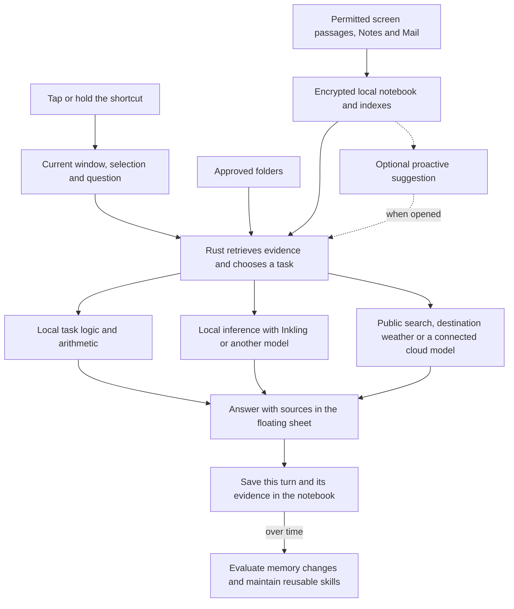

# How Beside works

In the [writing walkthrough](https://pranavdulepet.github.io/beside/#writing), an essay attributes the 64 gates of Chandragupta’s capital to an excavation. The writer selects the claim in TextEdit. Beside finds two research notes, quotes the passage about excavated timber and the one attributing the gate count to Megasthenes, and suggests a sentence the writer can use. The writer decides what goes back into the essay. [Essay and source notes](../examples/writing)

## From the shortcut to the answer

1. **Capture what the question refers to.** A tap on **⌥⇧Space** takes a snapshot of the pointer target, front window and available selection before the floating sheet takes focus. Holding the shortcut starts on-device speech recognition. The React sheet sends the question and its context to the Rust process through Tauri. The notebook is a second view into that same process. [Shortcut and windows](../src-tauri/src/main.rs) · [Pointer targeting](../src-tauri/src/point.rs) · [Speech](../src-tauri/voice.m) · [Floating sheet](../src/Activity.tsx)
2. **Find evidence.** Rust looks up eligible passages by text, source and time. SQLite FTS5 ranks word matches with BM25. A 192-dimensional vector index helps when there are few text matches. A question about “anything in my notes or email” uses the current screen as the search clue and retrieves the other source independently. A saved connection carries its quoted passage and source identity so Beside can check it again. Queries about files search the folders the user granted. [Activity search](../src-tauri/src/activity.rs) · [Connections](../src-tauri/src/activity/connections.rs) · [File access](../src-tauri/src/activity_files.rs)
3. **Choose how to answer.** The floating companion has dedicated paths for tasks such as comparing baggage, preparing a shopping list, finding a related passage and drafting a reply. Other questions use a model with a bounded set of excerpts. The notebook conversation has its own router for model choice, arithmetic, dates, recall, public search and saved skills. Rust validates tool requests before execution. [Companion routing](../src-tauri/src/activity.rs) · [Notebook routing](../src-tauri/src/conversation.rs) · [Notebook tools](../src-tauri/src/desk_tools.rs)
4. **Return to the work.** The sheet can render text as it arrives, plus the supporting quotes or links. The user can open a source, copy a draft, correct the answer or dismiss the sheet. Floating chat turns and the excerpts used for them are stored together. A task follow-up must match the same chat, last turn, task type and current generation of screen memory. This keeps a correction in one chat from silently revising a different task. [Sheet](../src/Activity.tsx) · [Chat persistence and revision](../src-tauri/src/floating_chats.rs)

“What am I reading right now?” uses the window captured when you pressed the shortcut. “What was I just reading?” looks up a recently saved passage by time. For a text answer about either screen, Beside asks the local model to choose a supporting line. If the first interpretation misses, it reads the surrounding lines from that same screen again. An uncertain result shows what was legible. [Screen recall](../src-tauri/src/activity.rs)

### Revising a shopping list

A shopping question uses the meal plan in the current window, or a saved itemized plan if the user asks from somewhere else. When several plans match, Beside asks which to use. For a plan with dates, portions and ingredient quantities, Rust records the schedule and pantry alongside the answer in that floating chat. Changing Thursday’s head count rescales that dinner. Updating the pantry replaces the earlier count and subtracts it from the new totals. A copy action puts the resulting list on the clipboard, ready to paste into Notes. [Meal plans and revisions](../src-tauri/src/activity/meal_plan.rs) · [Shopping list retrieval](../src-tauri/src/activity/shopping.rs)

### Reading a supported airline checkout

At a checked-bag selector, Beside reads the active HTTPS browser window and the control under the pointer. It looks for a single traveler, one outbound route and date, a weight allowance, an included quantity, the current quantity and the price attached to that bag. The Accessibility reader works across sites that expose those labels in English. It keeps the hostname and original labels with the answer. Conflicting prices, several passengers or ambiguous legs prevent a price recommendation. [Checkout evidence](../src-tauri/src/activity/baggage/checkout.rs) · [Native window reader](../src-tauri/activity.m)

Ryanair’s **Check-in Bags** page also has an on-device Vision reader for **All displays**. It binds the visible browser address and tab to the fare column under the pointer. United’s fee calculator has a separate reader for a single route’s first fee, second fee and weight limit. [On-device text recognition](../src-tauri/bag_vision.m) · [Matching the price to the bag](../src-tauri/src/activity/baggage/vision.rs)

The destination and departure date help Beside select a saved packing note. It can recognize an inventory by the things listed even when the title just says “Things to bring.” Competing dated lists must match the itinerary. Beside uses quantities and item-weight ranges, including the suitcase, to estimate the packed weight. A scale reading in the same chat replaces that estimate. The recommendation distinguishes a first paid bag, an included bag and an extra bag already selected. If the available evidence could change the choice, Beside asks for the missing detail. [Booking and list matching](../src-tauri/src/activity/baggage.rs) · [Packing estimates](../src-tauri/src/activity/packing.rs)

The local recommendation can appear while Beside fetches the weather. With destination forecasts enabled, it resolves the arrival airport using its bundled OurAirports table and requests a 16-day forecast from Open-Meteo using rounded coordinates. Beside selects the outbound date on the Mac, checks the reported units and links the forecast it actually used. The per-airport forecast stays in memory for up to an hour. A missing airport, unverified date or unavailable daily forecast leaves weather out of the recommendation. [Destination weather](../src-tauri/src/activity/trip_weather.rs)

## What Beside can see

Screen memory uses macOS permissions and the scope chosen in Sources. Native code reads window information, Accessibility text where available and Vision OCR. The observer samples changes as windows settle, deduplicates repeat views, and saves a timestamp, source, title and passage. Optional image previews have a separate retention limit. The observer checks the lock state, secure input and excluded apps. **Last seen** reports observation separately from the last newly saved passage. [Native capture](../src-tauri/activity.m) · [Observer](../src-tauri/src/activity.rs)

With **Only when I ask**, the shortcut can read one pointed window for one local answer. Beside checks the window again before using it. Dismissing the sheet or revoking access invalidates that capture. The chat can keep the question, answer and supporting line. The original window image and body stay out of the activity journal and hosted model requests. [Pointer capture and lifetime](../src-tauri/src/point.rs) · [Local dispatch](../src-tauri/src/activity.rs)

Under **All displays**, the user can also include other open windows in local answers. Beside rotates through eligible windows and holds the recent excerpts in RAM. Coverage depends on what macOS exposes. A browser tab without its own window is outside this view. Apple Notes and exported Mail have separate, refreshable imports. Meeting recording has an explicit start, system window picker and stop, with optional microphone capture. [Other windows](../src-tauri/src/activity/workspace.rs) · [Imports](../src-tauri/src/activity/imported.rs) · [Meetings](../src-tauri/src/meetings.rs)

### How a passage becomes a suggestion

1. With observation and suggestions enabled, the foreground observer checks window identity about every 250 ms. A change triggers a sample and a second look after roughly 550 ms so the editor can settle. A stable window is sampled about every five seconds. The capture work itself can add time. [Capture schedule](../src-tauri/src/activity.rs)
2. A new passage starts a local search. Beside looks for an independent Notes or Mail passage with distinctive terms in common and useful wording missing from the screen. Eligible open windows and refreshed imports can supply evidence too. Failing that, it tries a relevant saved preference, a visible error or a message that merits a reply. A weak match leaves the menu bar quiet. This decision uses local retrieval and rules. [Candidate selection](../src-tauri/src/proactive.rs)
3. The best eligible suggestion carries its originating passage ID. A topic change inside the same window can withdraw the dot on its next captured passage. A continuing match follows the latest passage and retains its original expiry. New dots have a 90-second default cooldown, and a dot expires after four minutes. A new dot waits for a brief pause in typing. Opening it consumes that offer. Dismissing it silences that same suggestion for seven days, including across restarts. The encrypted notebook stores up to 100 dismissal hashes with expiry times. [Suggestion lifetime](../src-tauri/src/proactive.rs)
4. A local model can warm while the dot is available. Choosing **Show connection** checks the source and permissions again. The sheet can show the verified line while Inkling explains its relevance. Generating an explanation and contacting a public search service are both outside the background matching path. [Menu bar](../src-tauri/src/main.rs) · [Opening a connection](../src-tauri/src/activity.rs)

## Models and network boundaries

The managed runtime launches a bundled llama.cpp server on loopback, loads GGUF weights and uses Metal on Apple Silicon. Beside can keep the model warm between requests. The managed download offers **Inkling 2 Mini** on Macs with at least 32 GB of memory and **Gemma 4 12B** starting at 16 GB. Weights download separately and are checked against a pinned digest. Beside can also use an existing Ollama or LM Studio setup. [Managed runtime](../src-tauri/src/bundled.rs) · [Model selection and downloads](../src-tauri/src/weights.rs) · [Inference](../src-tauri/src/brain.rs)

The floating sheet uses Rust arithmetic for quantities and weight limits. Comparing two research notes uses the local model to propose a revision and Rust to check the citations. General questions use the provider chosen in Settings. In a notebook conversation with a connected ChatGPT plan, the router can keep quick work on an available local model and use the plan for a harder question. A private notebook request requires a local model. [Companion dispatch](../src-tauri/src/activity.rs) · [Notebook model choice](../src-tauri/src/conversation.rs)

Both interfaces use Exa for public search and page retrieval. A transient failure can retry once at the same endpoint within the original 22-second timeout. If the floating sheet needs a public topic, the next typed reply can supply it. A self-contained public lookup in the ordinary floating chat sends the public terms to Exa and gives the answering model just the question and the selected passages. The user can expand a source to read the quote in place or open the publisher. For a weekend plan, Beside looks up the city, dates and broad interests. It reads the listings, screens for closure notices and looks for the area in the page or its publisher’s domain. A dated activity and the current preferences determine the pick locally. If it can only find undated listings, it offers the links and says which detail is missing. An offline notebook sheet keeps its web tools off. [Public query policy and retrieval](../src-tauri/src/web_search.rs) · [Source display](../src/Activity.tsx)

A connected cloud model is a separate choice. Depending on the route and sharing settings, it can receive the question, eligible excerpts or a permitted image. At dispatch, the companion filters personal memory, limits conversation history to turns already shared with that provider, and removes the other-open-windows snapshot. Connected options include a ChatGPT plan and configured provider endpoints. A local answer based on local sources runs on the Mac. [Sharing boundary](../src-tauri/src/brain.rs) · [Providers](../src-tauri/src/providers.rs)

## What lives on disk

New notebooks live in `~/Beside`. The storage format depends on whether Beside or the user needs to read it directly.

| Location inside the notebook | Contents |
| --- | --- |
| `.sumi/moments.db` | SQLCipher database for captured passages, optional previews, imported material, floating chats, evidence indexes, predictions and settings. macOS Keychain holds the per-notebook key. The hidden path preserves compatibility with existing notebooks. |
| `desk/` | Readable Markdown for notebook conversations, memory pages and the compact personal summary. Floating chats use the encrypted database. |
| `scroll/` | Approved preferences, relationships and named skills in Markdown. Retired skills have their own directory. |
| `.sumi/activity-journal/` and `.sumi/meetings/` | Optional readable daily screen journals and ordinary meeting MP4s. These have different privacy properties from the encrypted database. |
| `.sumi/models/` | Downloaded local model weights. |

Screen passages age out after 30 days. Previews are limited to 24 hours and the most recent 150. Removing a captured passage invalidates linked evidence, including saved floating chats citing that passage. Removing a Notes or Mail import clears its search index. A quote already saved in a chat or portable export can still exist there. Export produces a readable archive, so access to that copy matters. [Database](../src-tauri/src/store.rs) · [Activity schema](../src-tauri/src/activity.sql) · [Export](../src-tauri/src/exports.rs) · [Storage controls](guide.md#where-your-data-lives)

## How Beside changes with use

**As a floating chat grows**, the local model selects which of the user’s statements to retain in a working document. The idle editor processes batches of up to six new turns and stores up to sixteen references in the encrypted notebook. Each identifies the turn, line and a hash of its wording. When the conversation exceeds the eight recent turns, a local answer can retrieve up to four relevant older passages and verify them against the original chat. A change of venue can replace the earlier choice in working context. The original conversation stays readable, and export renders the references as Markdown. Grocery quantities and baggage weights have their own arithmetic. This adapts the CLM idea of editable context to a fixed local model with a constrained set of edits. [Working context](../src-tauri/src/floating_chats/task_context.rs) · [Meal quantities](../src-tauri/src/activity/meal_plan.rs) · [Context Language Models](https://arxiv.org/abs/2609.37725)

**Across tasks**, telling Beside a new preference for project updates closes the old preference and makes the new one available to the next project draft. Inferred changes face a higher bar. The idle worker compares predictions with and without the proposed memory on later conversations. At least one prediction must improve and none may regress across at least two independent cases. A separate job tests changes to the prediction prompt and number of retrieved rules on a newer group of interactions reserved for confirmation. These checks adapt memory and the prediction settings with fixed model weights. [Dated memory and replay](../src-tauri/src/memory.rs) · [Policy tuning](../src-tauri/src/jobs.rs) · [Reglos](https://arxiv.org/abs/2611.06049)

The notebook’s prediction history makes part of that loop inspectable. Imported conversations supply situations paired with what the user actually did. Beside separates examples used to find patterns from examples reserved for evaluation. A scored entry records the baseline guess, personalized guess, observed outcome, rules used and grade. That score measures agreement with a held-out user action. Factual answers still depend on their sources. For a writing comparison, local Inkling returns revised prose and the IDs of independently retrieved excerpts. Rust resolves the IDs to exact saved text, rejects repeated documents and checks digits in the revision against those excerpts. [Source preparation](../src-tauri/src/sources.rs) · [Prediction and scoring](../src-tauri/src/engine.rs) · [Prediction history](../src-tauri/src/mirror.rs)

The notebook can also turn repeated successful work into a named Markdown skill, select it for a later conversation, and retire it as usage changes. Approved parts of the Scroll can be shared with a connected agent through a local MCP endpoint. Each agent has revocable credentials, permitted sections and a permission level. Decisions outside its delegated scope can come back to the user. [Skills](../src-tauri/src/conversation.rs) · [Agent permissions](../src-tauri/src/seal.rs) · [Local transport](../src-tauri/src/transport.rs)

## Build and delivery

The app packages its React and TypeScript interface, Tauri Rust process, native macOS bridges and inference runtime together. The release ZIP and static GitHub Pages gallery are distribution channels. A running notebook has no dependency on the gallery. Rust tests exercise retrieval, state changes and permission boundaries. Playwright covers interface flows and gallery playback. [Build, test and package](development.md) · [Release script](../scripts/release.sh) · [Browser tests](../tests/notebook.spec.ts)
