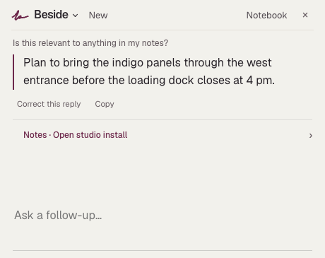

# Find the note behind a conversation

[Watch the floating sheet walkthrough (MP4)](https://github.com/pranavdulepet/beside/releases/latest/download/beside-first-question.mp4)

A studio is expecting a delivery of indigo panels. The conversation mentions the loading dock. An earlier installation note says when it closes and which entrance to use.

1. With the delivery question visible, summon Beside with **Option–Shift–Space**.
2. Ask **“Is this relevant to anything in my notes?”** You can describe what you need without remembering the note title.
3. Read the answer, then click **Open studio install** beneath it. The exact wording appears in place.

The recording uses the floating interface and local Inkling with a temporary notebook. The delivery conversation and note are sample data. The video trims the wait for inference. To try it with your own notes, choose **Import Apple Notes** under **Sources**. [Set up Beside](../README.md#try-beside)
